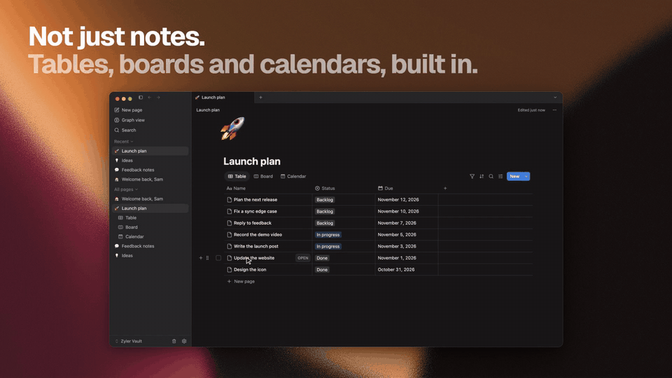

# Zyler

**Local-first notes. A rich block editor. Your own folder.**

Write and organize your notes in a desktop workspace with linked pages, databases, split panes,
and a terminal interface. Everyday note-taking works without an account.

[Download Zyler](https://github.com/ocai-labs/zyler/releases/latest) ·
[Website](https://zyler.app) · [Get started](docs/getting-started.md) ·
[What's new](https://github.com/ocai-labs/zyler/releases) · [Get help](SUPPORT.md)

## Download

| Platform | Installer | Architecture |
| --- | --- | --- |
| macOS | `.dmg` | Apple Silicon (arm64) |
| Windows | `Zyler-Setup-*.exe` | x64 |
| Linux | `.AppImage` | x64 |

Choose your installer from the [latest release](https://github.com/ocai-labs/zyler/releases/latest).
The macOS `.zip` and update metadata are used by the updater; the `.dmg` is for a first install.
See [installation](docs/installation.md) for platform details.

## A workspace for your notes

- **Write with Rune.** Use headings, tasks, tables, code blocks, columns, and drag-and-drop blocks.
  A PDF block shows a document in the page and opens full screen when you press Space.
- **Organize with databases.** Turn any page into a table, board, calendar, list, or gallery.
  Filter, sort, and group each view, and start new rows from templates.
  See the [databases guide](docs/databases.md).
- **Connect ideas.** Link pages with wiki-links and explore their connections in graph view.
- **Keep context nearby.** Open notes in tabs and split panes.
- **Keep your files.** Store notes in a local vault, with per-note version history.
- **Sync every device.** Optional end-to-end encrypted Sync keeps a vault the same on iPhone, iPad,
  Mac, Windows, and Linux. See the [Sync guide](docs/sync.md).
- **Bring your own AI.** Zyler has no built-in AI. Connect the assistant you already use through the
  bundled `zyler` CLI, which can list, search, read, and write notes even when the desktop app is closed.
- **Bring notes in and out.** Import Markdown, text, or HTML; export individual pages as Markdown or PDF.

Local notes never depend on signing in. A Zyler account is needed only for Sync.
Check the app and [website](https://zyler.app) for current plans and terms.

## Coming from Notion?

Zyler's editor and databases will feel familiar: slash-menu blocks, toggles and callouts,
and table, board, calendar, list, and gallery views with row templates. The difference is
where your notes live: in a folder on your computer, with no account needed. Read
[Coming from Notion](docs/coming-from-notion.md) to move pages over, or the
[Notion alternatives guide](https://zyler.app/alternatives/notion) for an honest comparison.

## Try a real workflow

Start with the [quick start](docs/getting-started.md), then import a
[project-planning example](examples/project-planning/README.md) or choose a reusable template:

| Template | Use it for |
| --- | --- |
| [Meeting notes](templates/meeting-notes.md) | Decisions, discussion, and follow-up tasks |
| [Weekly review](templates/weekly-review.md) | Reflecting on the week and choosing what comes next |
| [Project brief](templates/project-brief.md) | Defining an outcome, scope, and next steps |
| [Daily note](templates/daily-note.md) | A short plan and log for one day |
| [Reading list](templates/reading-list.md) | Tracking what to read, what you finished, and what stuck |

These are Markdown files you can read on GitHub and import into Zyler. They are not vault files.
For repeatable database rows, create [row templates](docs/databases.md#row-templates) inside Zyler.

## Documentation and feedback

- [All guides](docs/README.md)
- [Your local vault and backups](docs/local-vaults.md)
- [Coming from Notion](docs/coming-from-notion.md)
- [Databases and row templates](docs/databases.md)
- [Sync](docs/sync.md)
- [Import and export](docs/import-export.md)
- [Command-line guide](docs/cli.md)
- [Privacy and connected features](docs/privacy.md)
- [Troubleshooting](docs/troubleshooting.md)
- [Report a bug or request a feature](https://github.com/ocai-labs/zyler/issues/new/choose)
- [Release notes and older downloads](https://github.com/ocai-labs/zyler/releases)

For account or billing questions, email [support@oceanai.so](mailto:support@oceanai.so).
Report security issues privately using our [security policy](SECURITY.md).

## About this repository

Maintained by [OCAI Labs](https://github.com/ocai-labs). This repository hosts official
downloads, user documentation, examples, templates, and community feedback.
Zyler's application source code is maintained privately.

Documentation, template, and example improvements are welcome; see
[contributing](CONTRIBUTING.md). App terms and privacy information are linked from the
[Zyler website](https://zyler.app).
