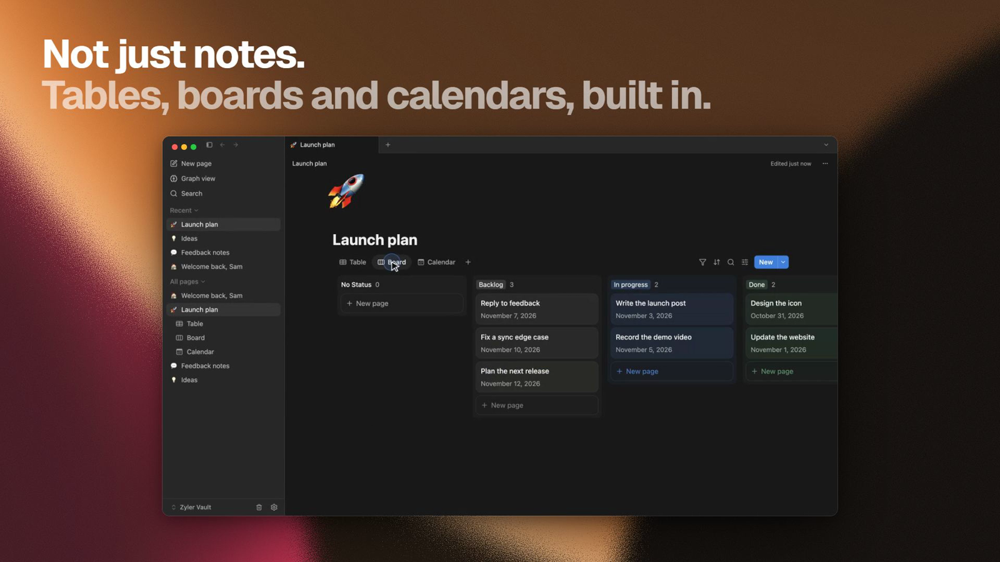

# Databases

A database turns a page into a collection of rows. Each row is its own page with
properties, such as a status, a date, or a file. Databases arrived in Zyler 0.18.

If you have used databases in Notion, the views, properties, and templates will feel familiar.
See [coming from Notion](coming-from-notion.md).

## Create a database

On an empty page, under **Get started with**, choose **Database** for a table. The
round **…** button beside it lists the other layouts. You can also embed a database view
inside any other page.

## Views

One database can have several views of the same rows:

| View | Good for |
| --- | --- |
| Table | Comparing properties across many rows |
| Board | Moving rows between columns, such as a status |
| Calendar | Rows with a date |
| List | A compact list of titles |
| Gallery | Rows with a cover or an image |

Each view has its own filter, sort, and grouping. Table views can show a calculation
row under a column, such as a count or a sum.

## Properties

A property is a column of values. Zyler supports text, numbers, select, multi-select,
status, dates, files, checkboxes, links, email, phone, and created and edited times.
Open a column's header menu and choose **Edit property** to rename it or change its settings.

A number can be shown as a **bar** or a **ring**, which suits progress and percentages.

## Open a row

Open a row beside the table (**Side peek**), in the middle of the window (**Center peek**),
or as a **Full page**. Choose which one in the peek's own menu.

## Row templates

A row template is a saved starting page. When you add a row from a template, the new
row begins with the template's properties and content.

1. Next to the **New** button, open the arrow (**More add options**).
2. Choose **New template**, then fill in the page that opens. A banner at the top tells
   you that you are editing a template rather than a row.
3. Add rows from that list. **Empty** creates a row with nothing prefilled.

Each template has an actions menu with **Set as default**, **Edit**, **Duplicate**, and
**Delete**. A default template is used by the **New** button. When you set one, Zyler asks
whether it applies to every view of the database or only the current view.

For Markdown starting points that
you import as ordinary pages, see the [page templates](../templates/README.md).

## Databases and other tools

Databases are part of the Zyler note format. Older versions of the app cannot open a vault
that uses them, so update every device before opening it. Markdown export of a page does not
carry a database's views, so use a [whole-vault backup](local-vaults.md#back-up-a-vault) to keep
one safe.
