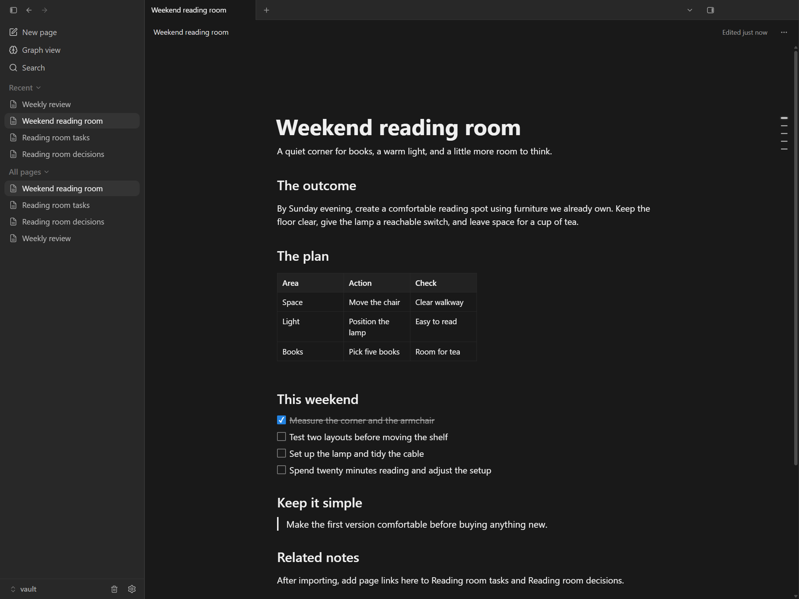

# Plan a weekend reading room

Try a small personal project: turn a quiet corner into a comfortable place to read.
The example uses fictional plans and contains three notes:

| File | Suggested page title | Purpose |
| --- | --- | --- |
| [Project overview](project-overview.md) | Weekend reading room | Define the outcome and scope |
| [Task list](task-list.md) | Reading room tasks | Track practical next steps |
| [Decision log](decision-log.md) | Reading room decisions | Remember why you chose an option |

## Import the notes

1. Download each note's raw `.md` file. You can also download this repository as a ZIP
   from GitHub's **Code → Download ZIP** menu and extract it first.
2. Open a vault in Zyler.
3. Go to **Settings → Import → Text & Markdown**, choose one file, select its
   location, and click **Continue**. Repeat for the other two files.
4. Give the pages the suggested titles above.
5. In **Weekend reading room**, type `[[` and select **Reading room tasks**.
   Repeat for **Reading room decisions**. Importing separate Markdown files does
   not automatically wire these page links.

## Try the workflow

- In the overview, change the outcome to fit a project you actually want to finish.
- In the task list, check a task, add another, and move a block with its drag handle.
- Record a choice in the decision log before you forget why you made it.
- Open the overview and task list in separate panes to plan with context nearby.
- Export a page as Markdown and inspect it in a text editor.

The screenshot uses this example's sample content in the desktop app.
See [getting started](../../docs/getting-started.md) for help with the basic workflow.
